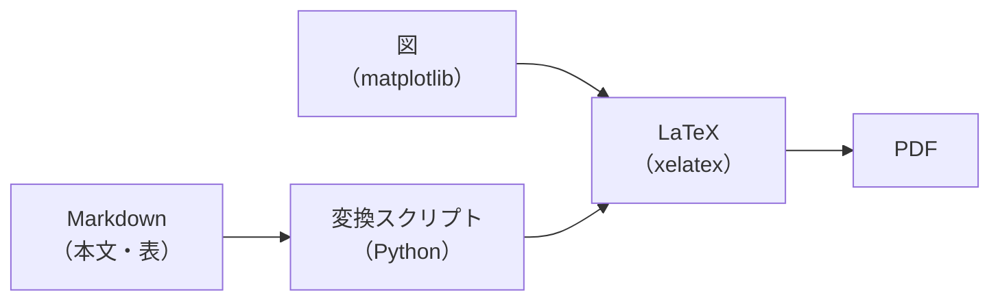

# 第12章　PDF と Zenodo

> **この章で学ぶこと**
> 1. Markdown から PDF を作る**手順**
> 2. **公開版は、作業版から作り分ける**
> 3. Zenodo 登録の**手順**と、つまずき

---

## 12-1　PDF を作る

4 本の論文の PDF は、**Markdown で書き、LaTeX に変換して組版**しました。



- **本文：** Markdown（見出し、表、箇条書き、図、引用ブロック。引用ブロックは、枠つきの囲みに組版する）
- **変換：** Python のスクリプトが、LaTeX に変換する。数式の断片（添字など）を、数式モードに直す
- **組版：** xelatex。日本語のフォント（游ゴシック）を使う
- **図：** matplotlib（日本語ラベルのため、游ゴシックを指定）
- **7 列以上の表：** 横向きのページ（landscape）にする

:::message
**同じ変換の仕組みを、4 本で使い回しました。** IN-01 で作った変換スクリプトを、IN-02、DB-01、NS-01 でも読み込みました。表紙と要旨だけを、論文ごとに差し替えます。
:::

---

## 12-2　公開版は、作業版から作り分ける

作業中の文書には、**内部用の記述**が混ざります。たとえば、

- 作業用のファイル名、内部の計画書への言及
- 「公開前に〜する」という作業メモ
- 「私の読み」のような、AI の一人称
- 「草稿」「未公開」という表示

**これらが、公開版に残ると、読む人を混乱させます。** そこで、**作業版（草稿）と公開版を、別々に作りました**。

```
草稿の Markdown（作業用）
　　↓  公開版を作るスクリプト（置き換えを、1 つずつ確認しながら実行）
公開版の Markdown
　　↓  変換・組版
公開版の PDF
```

置き換えは、**1 つずつ、「元の文が本当にあるか」を確認して**実行します（なければ、エラーで止める）。IN-02 の公開版では、十数か所を置き換え、付録 D（公開前の確認項目）を削除しました。

:::message
**教本ネタ #67　「公開版は、作業版から作り分ける」**
作業版を、そのまま公開しません。内部用の記述を、**スクリプトで除去**し、除去した結果を**目で確認**します。作業版は、**そのまま残します**（あとで、改訂版を作るため）。
:::

---

## 12-3　Zenodo に登録する

論文は、**Zenodo**（研究データの公開サービス）に登録し、DOI をもらいました。登録の手順です。

1. **登録スクリプトを作る**（AI が作成）：PowerShell で、Zenodo の API を呼ぶ
2. **通信なしの確認（DryRun）：** 題名、要旨、キーワード、参考文献、ファイル名を表示して、確認
3. **著者が、自分の端末で実行**：トークンを環境変数に設定し、下書きまで作る
4. **下書きを、Zenodo の画面で確認**：日本語、ファイル、メタデータ
5. **著者が、公開**：公開のコマンドを実行する

登録の内容は、次のようにそろえました。

| 項目 | 内容 |
|---|---|
| 題名 | 「Paper IN-02: …」のように、**「Paper コード名:」で始める**（検索のため） |
| ライセンス | CC BY 4.0（表示 4.0 国際） |
| 版 | v1.0 |
| 言語 | 日本語（jpn） |
| 関連する論文 | 前の論文に `continues`、参照した論文に `references` |
| 参考文献 | arXiv ID、DOI |
| 添付ファイル | PDF、スクリプトの zip、README |

**PDF の SHA-256 ハッシュを、記録**しました。あとで、公開したものと手元のものが同じか、確かめられます。

---

## 12-4　つまずき

制作中に、**5 つのつまずき**がありました。

### ① 日本語のメタデータが、文字化けした（IN-01）

PowerShell のスクリプトに、日本語の題名や要旨を入れて、**BOM なしの UTF-8**で保存すると、Windows PowerShell 5.1 が、**ANSI として読み**ました。結果、Zenodo の題名と要旨が、文字化けしました（著者が、画面で再入力）。

**直し方：** 日本語を含むスクリプトは、**BOM つきの UTF-8**で保存する。

:::message
**教本ネタ #69　「日本語のメタデータは BOM」**
BOM なしで保存すると、文字化けします。IN-02 以降は、BOM つきで保存し、DryRun で日本語が保たれることを確認してから渡しました。**IN-02 の登録では、文字化けはありませんでした**（DB-01・NS-01 も、同じ手順です）。
:::

### ② 表の `|` が、列の区切りになった（IN-02）

表のセルに、絶対値の記号（`|f_NL|`）を書くと、**Markdown の列の区切り**として読まれ、行が欠けました。

**直し方：** セルの文言を、「f_NL の絶対値」に変える。

:::message
**教本ネタ #68　「表の `|` が、行を壊す」**
表のセルに、縦棒を書きません。PDF を作る前に、**表の行数と、列数を確認**します。
:::

### ③ ヘッダーの `_` が、「Missing $ inserted」を起こした（NS-01）

ページのヘッダーに、n_s のアンダースコアを書くと、**改ページのときに**、LaTeX のエラーになりました。**直し方：** `\_` にする。

### ④ バックスラッシュが、半分になった

スクリプトを書き込むとき、`\\` が `\` になり、改行や `\[2pt]`（数式の開始）として**誤って解釈**されました。**直し方：** バックスラッシュは、`chr(92)` で作る。

### ⑤ PDF から日本語のテキストが抽出できない

組版した PDF を、テキストとして検索しようとすると、**日本語が落ちました**。PDF の中身を確かめるには、**画像に変換して、目で見る**ほうが確実でした（縮小一覧にして、全体を確認）。

---

## 12-5　公開の前の確認

付録 B に、チェックリストをまとめました。要点は、次のとおりです。

1. 数値は、スクリプトの出力と、本文を**突き合わせた**
2. 内部用の記述を、**除去した**（公開版を、作業版から作り直した）
3. 参考文献の書誌を、**確認した**（印つき）
4. 図と表を、**目で見た**
5. ハッシュを、**記録した**
6. Zenodo の下書きで、**日本語とファイルを確認した**（公開前）

---

## 演習 12

**やってみよう。**

1. 手元の文書を、Markdown で書き、**PDF にする方法**を、1 つ決めてください（LaTeX、Pandoc など）
2. **作業版の文書**から、内部用の記述を、**列挙**してください。除去するスクリプトの方針を、書いてください
3. Zenodo の**テスト用サイト**（sandbox）で、**下書きの登録**を試してください（公開はしない）
4. 日本語を含む文字列を、スクリプトで送るとき、**文字化けしないか**を、確認してください
