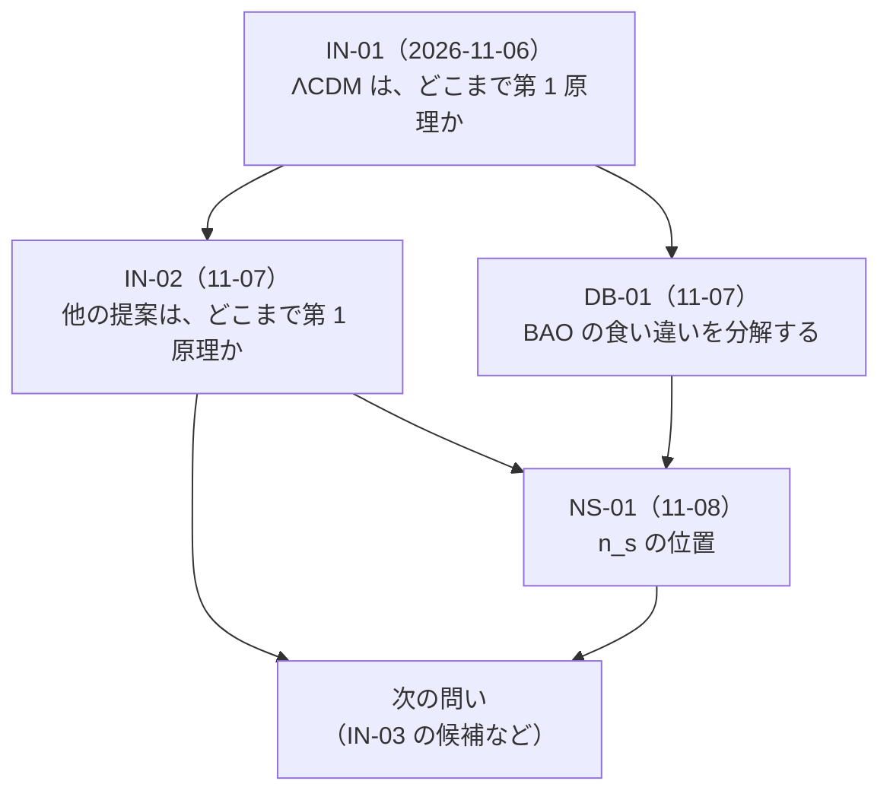

# 第14章　次の問いを残す

> **この章で学ぶこと**
> 1. 論文の**連鎖**
> 2. **公開したあとの訂正**の扱い
> 3. 前の結論を、**後で自分で更新する**

---

## 14-1　論文の連鎖

『実践編-1』は、「**答えより問いが長生きする**」と教えました。Open Question（OQ）が、次の論文を生む、と。整理型でも同じです。

3 日間で、4 本の論文を公開しました。**大きい論文（IN-01、IN-02）の執筆中に、メモしておいた問いが、軽い論文（DB-01、NS-01）になりました。**

---

## 14-2　「次の検証」の節

各論文の最後に、**「次の検証」**の節を置きました。**何が変わると、結論が変わるか**を書く節です（第 4 章）。

IN-02 の 9.4 節には、次の表があります。

| 事象 | 何が変わるか |
|---|---|
| r の検出 | BFT の「インフレーションなし」版、エキピロティックの「r≈0」が反証される |
| Σm_ν が約 0.059 eV を下回る | 最軽ニュートリノが質量ゼロの模型全般が、圧力を受ける |
| f_NL の誤差が約 1 に縮む | エキピロティックの 2014 年版が、検定可能になる |
| DESI DR3 の BAO | ΛCDM 側の圧力が、どちらに動くか |

さらに、9.6 節（次の探索の入り口）に、**次に確認すること**（BFT 後続の本文確認、エキピロティック 2014 年版の n_s と r、AeST の再検索、ΛCDM の圧力への答え）を書きました。**この一覧が、次の論文と、公開後の訂正の、出発点**になりました。

---

## 14-3　公開したあとの訂正

論文を公開すると、あとから、**確認が進む**ことがあります。IN-02 の公開のあと、次の確認をしました。

| 確認 | 結果 |
|---|---|
| Cline と Hell への、著者側の応答の再検索 | **直接の応答は見つからず**。Krein 空間による量子化を提案する論文は見つかった |
| AeST の定量的な当てはめの再検索 | **見つからず** |
| IN-01 の n_s の値（二次情報だったもの） | **原典で確認できた** |

**公開した版（v1.0）は、書き換えません。** 代わりに、次のようにしました。

1. **作業版（草稿）の Markdown に、確認の結果を追記**する（第 4 章 4.11 節、第 3 章 3.9 節など）
2. **計画書に、「v1.1 への反映待ち」として記録**する
3. **新しいバージョン（v1.1）の公開は、著者の指示を待つ**（Zenodo は、同じ DOI のグループに、新しい版を登録できる）
4. 公開後の確認は、**日誌にも記録**する

:::message
**教本ネタ #72　「前の検定を、後で自分で訂正する」**
公開した結論は、あとから変わることがあります。変わったら、**新しい版で訂正**し、**どこが、なぜ変わったか**を書きます。IN-02 では、エキピロティックの 2010 年の予言が排除された（約 7.7σ）あとで、2014 年の模型が合う（約 1.2σ）ことを調べ、結論を**更新**しました。
:::

---

## 14-4　前の論文との整合

新しい論文を書くとき、**前の論文の数値と、整合しているか**を、確認しました。

- NS-01 では、IN-01 の「P-ACT-LB の n_s = 0.9743 ± 0.0034」を、ACT DR6 の**本文の表で確認**した。
- IN-01 の「CMB に BICEP/Keck を加えた n_s = 0.9682 ± 0.0032」を、**別の論文**で確認した（第 11 章。一度は、探した論文を間違えて、「訂正候補」と書いた）。
- IN-02 の「BFT と ACT の差 約 4.8σ」を、NS-01 の表の値（P-ACT-LB と −4.8σ）と**照合**した。

**新しい論文の「照合」の節は、前の論文の誤りを、見つける場でもあります。**

---

## 14-5　軽いノートと、重いノート

この 3 日間で、2 種類のノートを書きました。

| | 軽いノート | 重いノート |
|---|---|---|
| 例 | DB-01（9 頁）、NS-01（9 頁） | IN-01（72 頁）、IN-02（47 頁） |
| 問い | 1 つの表、1 つの数 | 理論全体、複数の提案 |
| 時間 | 1 日 | 数日 |
| 材料 | 前の論文のスクリプトと数値 | 一次文献の読み込み |
| 位置づけ | 重いノートの**続き**、**更新** | 土台 |

**軽いノートは、重いノートの「次の問い」から生まれます。** 重いノートを書いている間に、問いをメモしておくと、あとで軽いノートにできます。

---

## 14-6　おわりに

この本は、**予言を持たない論文**の書き方を扱いました。まとめます。

1. **何を主張しないか**を、先に決める（第 1 章）
2. 問いを、**「どこまで」の形**にする（第 2 章）
3. **物差し**を先に作り、**点数を足さない**（第 3 章）
4. **当てはめと検定**を分け、「何が変わると結論が変わるか」を書く（第 4 章）
5. **確認の深さ**を、主張ごとに、印で示す（第 5 章）
6. **自分の手で再現**し、**算術はスクリプト**で（第 6 章）
7. **食い違いを分解**し、事後の選別と書き、先行研究と突き合わせる（第 7 章）
8. **反論を併記**し、判定しない（第 8 章）
9. **古い資料と未読**を、正直に書く（第 9 章）
10. **通知表**で、履行報告をする（第 10 章）
11. **AI の貢献と責任**を分けて書き、間違いを記録する（第 11 章）
12. **公開版を、作業版から作り分け**、BOM、`|`、ハッシュに気をつける（第 12 章）
13. **測り、事実と仮説を分け、結論は数字が出てから**（第 13 章）
14. **次の問いを残す**（本章）

**素人でも、AI と一緒に、公開データと公開論文だけで、価値のある論文が書けます。** ただし、**間違えます**。間違えたら、**記録して、直して、次の版に反映する**。それが、この技法の核心です。

付録 C の失敗集を、もう一度、見てください。**間違いの数は、技法の欠陥ではなく、確認を重ねた証拠**です。

---

## 演習 14

**やってみよう。**

1. 自分の論文（または計画）に、**「次の検証」の節**を書いてください（何が変わると、結論が変わるか、3 つ以上）
2. 公開した（または公開する）論文の、**訂正の運用**を決めてください（作業版に追記、計画書に記録、新しい版を出す条件）
3. 論文を書いている最中に出た、**別の問い**を、3 つメモしてください。**1 日で書ける軽いノート**にできそうなものを、1 つ選んでください
4. 前の論文（または文書）の数値を、**新しい論文の「照合」の節**で、確認してください
