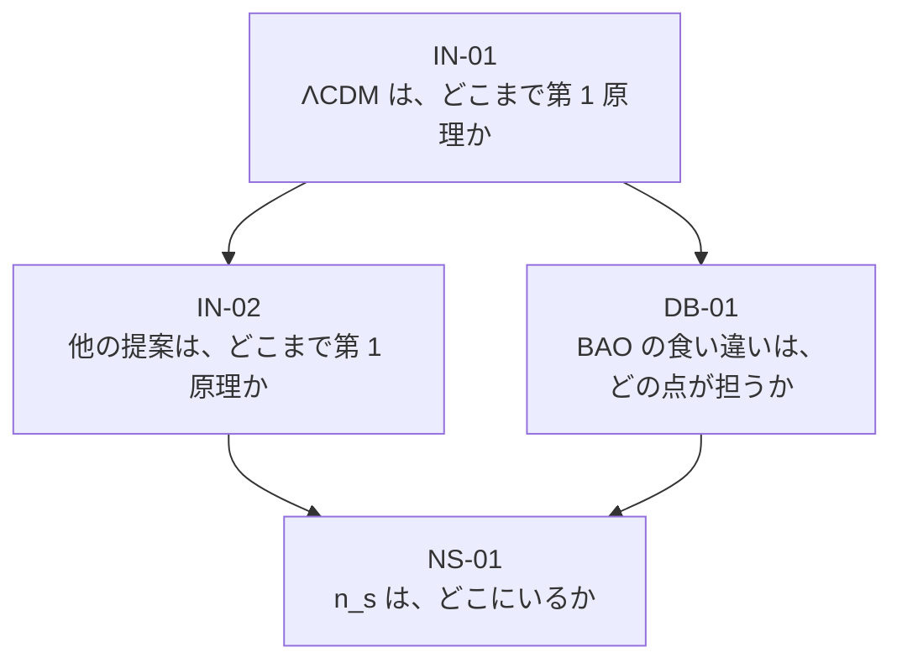

# 第2章　問いを「整理の問い」に変える

> **この章で学ぶこと**
> 1. 良い問いの三条件を、**整理型**に当てはめる
> 2. 問いは、**「どこまで」の形**にすると、答えが数で出る
> 3. 答えが、**次の問い**を生む

---

## 2-1　悪い問いと、良い問い

『実践編-1』は、良い問いの三条件を示しました。**具体性、反証可能性、連鎖性**です。整理型でも、この三条件は使えます。

まず、悪い問いの例を見てみましょう。

```
「宇宙論は、正しいのか」
```

この問いは、答えられません。「正しい」の基準がなく、どの部分のことか分かりません。

少し良くしてみます。

```
「標準宇宙論（ΛCDM）は、なぜ成功しているのか」
```

まだ曖昧です。「成功」とは何か。「なぜ」は、何を答えれば満たされるのか。

---

## 2-2　整理型の問い：「どこまで」の形

IN-01 の問いは、次の形でした。

```
「標準宇宙論は、どこまで第 1 原理か」
```

**「どこまで」と聞くと、答えが数で出ます。** ΛCDM は、6 つの数（Ω_b h²、Ω_c h²、θ*、A_s、n_s、τ）で決まります。「そのうち、第 1 原理から導かれたものはいくつか」と読み替えれば、**答えは「0 個」と数えられます**（IN-01 の結論）。

三条件に照らしてみます。

| 条件 | この問いでは |
|---|---|
| **具体性** | 「第 1 原理」の意味（観測から決めた数を使わず、基本法則だけから導くこと）を決めた。数える対象（6 つの数）がある |
| **反証可能性** | 答えは数で出る。「第 1 原理から導かれた数が、1 つある」と示されれば、結論は覆る |
| **連鎖性** | 答えが、次の問いを生んだ（下の連鎖を参照） |

:::message
**教本ネタ #74　「問いは『どこまで』の形にする」**
「正しいか」ではなく「どこまで」。割合や個数で答えが出る問いは、**答えが間違っていたときに、気づける**問いです。
:::

---

## 2-3　問いの連鎖：IN-01 から NS-01 まで

4 本の論文は、問いの連鎖でできています。



- **IN-01 → IN-02:** ΛCDM の 6 つの数が導かれていないなら、**他の提案は導いているのか**。
- **IN-01 → DB-01:** IN-01 で、DESI の BAO と CMB に約 2.3σ の食い違いがあると書いた。**それは、13 個の数のうち、どれが担うのか。**
- **IN-02 → NS-01:** IN-02 で、BFT の n_s の予言と ACT の値の差に触れた。**最新の n_s の制限は、どこにあり、各模型はどこにいるのか。**

どの問いも、**前の論文を書いている途中で、見つかったもの**です。答えを出すと、次の問いが見えてきます。

---

## 2-4　問いを絞る：軽いノートと、重いノート

連鎖の中で、論文の大きさが変わりました。

| 論文 | 頁数 | 問いの大きさ |
|---|---|---|
| IN-01 | 72 頁 | ΛCDM 全体 |
| IN-02 | 47 頁 | 5 つの提案 |
| DB-01 | 9 頁 | 1 つの表（13 個の数） |
| NS-01 | 9 頁 | 1 つの数（n_s） |

問いが絞られるほど、1 日で書ける、**軽いノート**になります。

**コツ：大きな論文を書いている間に、「後で別の問いにできる」ものをメモしておく。** IN-01 の執筆中に、「論文の種」のメモ（S1〜S30）を残しておきました。DB-01 も NS-01 も、そのメモから生まれています。

---

## 演習 2

**やってみよう。**

1. 第 1 章の演習で選んだ分野で、次の 3 つの問いを書いてください
   - 悪い問い（答えられないもの）
   - 少し良い問い
   - 「どこまで」の形の問い
2. 「どこまで」の問いに、**数で答える方法**を、1 つ書いてください（例：個数、割合、差の σ）
3. その答えが出たとき、**次に出てくる問い**を、1 つ予想して書いてください
